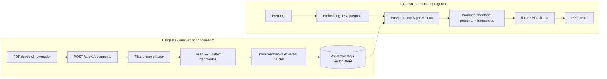

# Chat con documentos usando RAG (Spring AI + PGVector)

Taller del Módulo 2 de *Aplicaciones basadas en grandes modelos de lenguaje*. Programa de Ingeniería de Sistemas, Universidad El Bosque.

> Las secciones marcadas con `______` o `(PENDIENTE)` están por completar.

---

## 1. Integrantes y documento seleccionado

### Integrantes

| Nombre | Código / correo |
|---|---|
| Maida Alexandra Rojas Morato|mrojasmo@unbosque.edu.co |
|Jesus Daniel Torralba Cardenas |jtorralba@unbosque.edu.co|
|Paula Arias Buitrago|Pariasb@unbosque.edu.co|

### Documento

| Campo | Detalle |
|---|---|
| Documento | Reglamento Estudiantil de la Universidad El Bosque (Acuerdo No. 18573 de 2026, 28 de enero de 2026) |
| Número de páginas | 43 |
| Formato | PDF con texto seleccionable |
| Fuente (URL) | ______ |
| Fecha de descarga | ______ |
| ¿Por qué lo elegimos? | ______ (ideas: es un documento institucional con plazos, porcentajes y procedimientos concretos y verificables; es de 2026, así que llama3 no pudo haberlo visto en su entrenamiento; está escrito en español) |

**Nota sobre derechos de autor:** el documento indica "Todos los derechos reservados". Por esa razón **el PDF no se incluye en este repositorio**; debe descargarse desde la fuente indicada arriba. Confirmación del profesor sobre su uso: ______.

---

## 2. Arquitectura (explicada con nuestras palabras)

### Visión general

El sistema tiene dos flujos independientes: la **ingesta**, que se ejecuta una vez por documento, y la **consulta**, que se ejecuta en cada pregunta.



### Componentes

| Componente | Tecnología | Función |
|---|---|---|
| Frontend | HTML y JavaScript (`frontend/src/index.html`), servido por http-server en el puerto 4200 | Chat y botón de carga de documentos |
| Backend | Spring Boot 4.1 y Spring AI 2.0, puerto 8080 | Endpoints de carga y de chat |
| Modelo de chat | llama3 en Ollama | Genera la respuesta |
| Modelo de embeddings | nomic-embed-text en Ollama (768 dimensiones) | Convierte texto en vectores |
| Base vectorial | PostgreSQL 17 con pgvector (índice HNSW, distancia coseno) | Guarda texto, metadatos y vectores |
| Orquestación | Docker Compose | Levanta todo con un comando |

### Qué pasa al cargar un archivo

1. El navegador envía el PDF como `multipart/form-data` a `POST /api/v1/documents` (`DocumentController`).
2. `IngestionService` usa `TikaDocumentReader` para detectar el formato y extraer el texto.
3. `TokenTextSplitter` divide el texto en fragmentos de ~500 tokens (configurable).
4. Cada fragmento se guarda con el metadato `fuente` (nombre del archivo).
5. `vectorStore.add(...)` calcula el embedding de cada fragmento con nomic-embed-text y lo inserta en la tabla `vector_store`.

### Qué pasa al hacer una pregunta

1. `ChatController` recibe la pregunta y la envía a `SpringAiPromptTemplateModelService`, que es el servicio que realmente atiende el chat.
2. El `QuestionAnswerAdvisor` calcula el embedding de la pregunta con el **mismo** modelo de la ingesta.
3. Busca en PGVector los `topK` fragmentos más cercanos y descarta los que no alcanzan el umbral de similitud.
4. Inserta esos fragmentos en la plantilla de prompt (en español) junto con la pregunta.
5. llama3 genera la respuesta usando ese contexto. El modelo **no aprende** el documento: en cada pregunta recibe solo los fragmentos relevantes.

### Decisiones y detalles propios del proyecto

- El RAG se registró en `SpringAiPromptTemplateModelService` y no en `SpringAiModelService`, porque `ChatController` siempre invoca el primero. ______ (indicar si se limpió o se dejó comentado el advisor inactivo de `SpringAiModelService`).
- `num-ctx=4096`: la ventana por defecto de Ollama (2048) no alcanza para plantilla, fragmentos, pregunta y respuesta.
- `dimensions=768` debe coincidir con el modelo de embeddings.
- Los parámetros de recuperación (`rag.chunk-size`, `rag.top-k`, `rag.similarity-threshold`) se leen de variables de entorno (`RAG_CHUNK_SIZE`, `RAG_TOP_K`, `RAG_SIMILARITY_THRESHOLD`) para experimentar sin recompilar.
- Los timeouts se subieron (`read-timeout` del backend y `TIMEOUT_MS` del frontend) porque con RAG cada respuesta tarda entre 2 y 5 minutos en CPU. Valores actuales: ______.

### Estimación de fragmentos frente a resultado

Estimación previa: 43 páginas × ~500 palabras ≈ 21.500 palabras ≈ 28.700 tokens ≈ **57 fragmentos** de 500 tokens.
Resultado real: **55 fragmentos**. La diferencia se explica porque `withMinChunkSizeChars(200)` descarta o fusiona trozos muy cortos y el splitter corta en límites de oración.

---

## 3. Instrucciones de ejecución

### Requisitos

- Git y Docker Desktop (con el motor en ejecución).
- ~15 GB libres en disco (llama3 pesa ~4,7 GB) y 8 GB de RAM libres (mejor 16).
- El PDF del reglamento (no está en el repositorio).

### Pasos

```powershell
git clone ______
cd ______
docker compose -f docker/docker-compose.yml up -d --build
```

La primera vez tarda por la descarga de imágenes y de los modelos `llama3` y `nomic-embed-text`.

Verificación:

```powershell
docker compose -f docker/docker-compose.yml ps -a
docker exec -it pruebachat_ollama ollama list
docker logs pruebachat_backend 2>&1 | Select-String "RAG config"
```

Deben aparecer los dos modelos y la línea `RAG config` con los valores por defecto (`chunkSize=500`, `topK=4`, `threshold=0.5`). Los servicios `ollama-pull*` terminan en estado `Exited (0)`, y eso es normal.

### Uso

1. Abrir http://localhost:4200.
2. Seleccionar el PDF y pulsar **Cargar documento**. Debe aparecer `✓ ... 55 fragmentos indexados`.
3. Escribir preguntas en el chat. Esperar la respuesta de cada una antes de enviar otra.

### Cambiar la configuración de recuperación (Reto 2)

```powershell
$env:RAG_TOP_K = "6"                  # ejemplo
docker compose -f docker/docker-compose.yml up -d --force-recreate backend
docker logs pruebachat_backend 2>&1 | Select-String "RAG config"
```

Si cambia `RAG_CHUNK_SIZE`, hay que vaciar la tabla y volver a cargar el PDF:

```powershell
docker exec -it pruebachat_pgvector psql -U rag -d ragdb -c "TRUNCATE vector_store;"
```

### Apagar

```powershell
docker compose -f docker/docker-compose.yml stop        # conserva los datos
docker compose -f docker/docker-compose.yml down -v     # borra modelos y base de datos
```

### Problemas frecuentes

| Síntoma | Causa | Solución |
|---|---|---|
| Error de dimensiones al insertar | La tabla se creó con otra dimensión | `DROP TABLE vector_store;` y reiniciar el backend |
| 112 fragmentos en lugar de 55 | Quedó `RAG_CHUNK_SIZE=250` | Quitar la variable, `--force-recreate`, `TRUNCATE` y recargar |
| Fragmentos duplicados | El PDF se cargó dos veces | `TRUNCATE vector_store;` y cargar una vez |
| "Sin respuesta tras 300 s" | Timeout del frontend | Subir `TIMEOUT_MS` y `read-timeout` |
| "backend inalcanzable" en la barra | El backend está ocupado generando | Esperar a que termine |

---

## 4. Evidencias

### 4.1 Carga del documento

 ______ (captura de `✓ reglamento-estudiantil-2026.pdf: 55 fragmentos indexados en ... ms`)

Contenido guardado (consulta en psql): ______ (captura de `SELECT metadata->>'fuente', count(*) FROM vector_store GROUP BY 1;`)

### 4.2 Tabla del Paso 9: sin RAG frente a con RAG

Configuración "Con RAG": ronda A2 (chunk 500, topK 4, umbral 0,5, plantilla v2). Criterio: Sí = 1, Parcial = 0,5, No = 0.

| # | Pregunta | Respuesta esperada (pág.) | Sin RAG | Con RAG | ¿Correcta? |
|---|---|---|---|---|---|
| 1 | ¿Qué porcentaje de inasistencias hace que un estudiante pierda una asignatura por fallas? | 20 % o más de las sesiones (Art. 24.1, pág. 12) | "20-25 %", genérico, depende de la institución | Art. 24.1, 20 %, pero dice "más del 20 %" | Parcial |
| 2 | ¿Cuál es la nota mínima para aprobar una asignatura en pregrado y en posgrado? | Pregrado 3,0 y posgrado 3,5 (Art. 29, pág. 14) | Escala española sobre 10 | 3,0 y 3,5 | Sí |
| 3 | ¿Qué promedio debe tener un estudiante de pregrado para no entrar en prueba académica, y qué otra situación también lleva a prueba académica? | ≥ 3,3 y perder ≥ 60 % de créditos (Arts. 32.2 y 33, págs. 16-17) | "2.5" y "No Aprobado" | Dice "menor a 3,3" (invertido), otra causa vaga | No |
| 4 | Si no estoy de acuerdo con la nota que me puso un profesor, ¿cuántos días tengo para objetarla y ante quién? | 3 días hábiles, ante el mismo docente (Art. 31, pág. 16) | 5 días, docente o jefe | 5 días naturales, ante el Decano (Art. 80) | No |
| 5 | Si me transfiero desde otra universidad, ¿qué parte de la carrera tengo que cursar obligatoriamente en El Bosque? | Mínimo 50 % de créditos (Art. 10, pág. 6) | Módulos genéricos | Habla de movilidad y dice que no hay información | No |
| 6 | ¿Qué requisitos debo cumplir para obtener mi título? | 100 % de créditos, requisitos del Consejo y sin sanciones (Art. 41, pág. 20) | Lista genérica ("2.0 o C+") | Art. 41: 100 % y requisitos del Consejo; omite sanciones | Parcial |
| 7 | ¿Cuánto cuesta la matrícula de un semestre de Ingeniería de Sistemas? | No está en el documento | Inventa "$12,000 MXN" | Responde con el 30 % de matrícula reducida | No |

Resultado: sin RAG **0 / 7**; con RAG (A2) **2,0 / 7**. Con la plantilla v1 (ronda A) el resultado fue **3,5 / 7**.

> Nota metodológica: la pregunta 7 se formuló con "Ingeniería de Sistemas" y se mantuvo igual en todas las rondas.
> Nota metodológica: ______ (copiar aquí las respuestas literales completas o enlazar `evidencias/resultados.md`).

### 4.3 Capturas de respuestas

| Captura | Archivo |
|---|---|
| Respuesta sin RAG (P1) | ______ |
| Respuesta con RAG (P1) | ______ |
| Respuesta con RAG (P2, correcta) | ______ |
| Respuesta a la P7 (fuera del documento) | ______ |
| Log con los fragmentos recuperados (`source=...`, `score=...`) | ______ |

Detalle completo de cada ronda: [`evidencias/resultados.md`](evidencias/resultados.md).

---

## 5. Retos

### Reto 1: prompt en español y respuestas sin soporte

**Antes (plantilla por defecto del advisor, en inglés):** las respuestas comenzaban con "According to the Reglamento...". La P1 tardó ~155 s con un prompt de 2064 tokens.

**Después (plantilla propia en español):**

```
<query>

Información recuperada del documento:
---------------------
<question_answer_context>
---------------------

Reglas: ______  (pegar la versión final del prompt)
```

Se usan `<query>` y `<question_answer_context>` porque el servicio configura StringTemplate con los delimitadores `<` y `>`.

| Versión | Resultado |
|---|---|
| Plantilla en inglés (por defecto) | Responde con datos del reglamento pero en inglés y con errores ("más de 20 %") |
| v1 (estricta), sin documento | "No encuentro esta información en el documento." (correcto, no había documento) |
| v1, ronda A | 3,5 / 7 |
| v2 (suavizada), ronda A2 | 2,0 / 7 |

**Pregunta 7 (fuera del documento):** en ninguna ronda el sistema respondió que la información no está; contestó con porcentajes de matrícula reducida o matrícula intermedia, que sí aparecen en el reglamento pero no responden la pregunta.

**Conclusión:** ______ (idea: con llama3 8B suavizar la regla de rechazo no mejoró los resultados; los números de una sola ejecución con temperatura 0,7 tienen ruido, así que una diferencia de 1 o 2 puntos puede ser azar).

### Reto 2: experimentos con la recuperación

Una sola variable cambia por ronda respecto a A2. Todas usan la plantilla v2 (la ronda A usa v1 y solo sirve para el Reto 1).

| Ronda | Chunk | topK | Umbral | Plantilla | Fragmentos | Correctas /7 | Tiempo prom. | Observación |
|---|---|---|---|---|---|---|---|---|
| A | 500 | 4 | 0,5 | v1 | 55 | 3,5 | ~122 s | Referencia del Reto 1 |
| A2 (base) | 500 | 4 | 0,5 | v2 | 55 | 2,0 | ~190 s | Fallos de recuperación en P4 y P5 |
| B | 250 | 4 | 0,5 | v2 | 112 | 2,0 | ~87 s | Más rápida; igual calidad; artículos partidos |
| C | 500 | 6 | 0,5 | v2 | 55 | ___ | ___ | La P1 tardó ~301 s (venció el timeout de 300 s) |
| D | 500 | 4 | 0,7 | v2 | 55 | ___ | ___ | ______ |

Fuente de los datos: [`evidencias/resultados.md`](evidencias/resultados.md).

**Conclusiones basadas en los datos:**

- Tamaño de fragmento (A2 frente a B): ______ (dato: mismo puntaje, tiempo 2 veces menor con fragmentos pequeños).
- topK (A2 frente a C): ______
- Umbral (A2 frente a D): ______
- Mejor equilibrio calidad y tiempo: ______
- Fallos de recuperación frente a fallos de generación: ______ (P4 y P5 son de recuperación: el Art. 31 y el Art. 10 no llegaron al contexto; P1, P3 y P7 son de generación).
- Limitaciones del experimento: una sola ejecución por pregunta, temperatura 0,7, y tiempos afectados por la carga del equipo (la misma configuración tardó ~122 s en A y ~190 s en A2).

### Reto 3: mostrar la evidencia (PENDIENTE)

| Aspecto | Detalle |
|---|---|
| Qué se implementó | ______ (idea: leer `QuestionAnswerAdvisor.RETRIEVED_DOCUMENTS` desde `.call().chatClientResponse()`, extraer `fuente` y un extracto, ampliar el DTO de respuesta y mostrarlo en el frontend) |
| Archivos modificados | ______ |
| Captura del frontend mostrando la fuente | ______ |

---

## 6. Limitaciones observadas y mejora propuesta

### Limitaciones

- **Latencia alta en CPU:** 2 a 5 minutos por respuesta con RAG frente a ~20 s sin RAG; crece con `topK` (la P1 con `topK=6` tardó ~301 s).
- **Errores de generación:** el modelo invierte condiciones ("menor a 3,3" en lugar de "igual o mayor") y cambia "igual o superior al 20 %" por "más del 20 %".
- **Fallos de recuperación:** los artículos 10 y 31 no llegaron al contexto en varias rondas, y el modelo respondió con artículos no relacionados (movilidad, deberes, Art. 80).
- **Fragmentos partidos:** sin solapamiento, un artículo puede quedar dividido y perder el sujeto de la frase.
- **Texto sucio de Tika:** se cuelan letras sueltas del margen vertical del PDF ("@ U N I V E R S I D A D...") y tablas mal extraídas.
- **No rechaza bien lo que no está:** la pregunta 7 no obtuvo en ninguna ronda la respuesta "no está en el documento".
- **Duplicados:** cada carga del mismo PDF agrega fragmentos nuevos y no reemplaza los anteriores.
- ______

### Mejora propuesta

______ (elegir una y justificarla con los datos; opciones respaldadas por lo observado: chunking por artículo o con solapamiento para evitar artículos partidos; reranking para mejorar la recuperación de P4 y P5; evitar duplicados al re-subir el mismo archivo; limpiar el texto extraído por Tika; mostrar la página de origen; un modelo de chat más grande para reducir errores de generación).

---

## 7. Estructura del repositorio

```
backend/    Spring Boot (rag/IngestionService, rag/DocumentController, impl/SpringAiPromptTemplateModelService)
frontend/   index.html (chat y carga de documentos)
docker/     docker-compose.yml
evidencias/ capturas, logs y resultados.md
```

## 8. Referencias

1. Spring AI Reference: Retrieval Augmented Generation. https://docs.spring.io/spring-ai/reference/api/retrieval-augmented-generation.html
2. Spring AI Reference: ETL Pipeline. https://docs.spring.io/spring-ai/reference/api/etl-pipeline.html
3. Spring AI Reference: PGvector. https://docs.spring.io/spring-ai/reference/api/vectordbs/pgvector.html
4. Spring AI Reference: Ollama Embeddings. https://docs.spring.io/spring-ai/reference/api/embeddings/ollama-embeddings.html
5. Spring AI Reference: Advisors API. https://docs.spring.io/spring-ai/reference/api/advisors.html
6. pgvector. https://github.com/pgvector/pgvector
7. Lewis, P. et al. (2020). Retrieval-Augmented Generation for Knowledge-Intensive NLP Tasks. NeurIPS 2020. https://arxiv.org/abs/2005.11401


---

## Anexo: contrato de la API del chat (proyecto base)

`POST /api/v1/chat` conserva sus propiedades de petición y respuesta originales. Las respuestas
exitosas incluyen además `promptTokens`, `completionTokens`, `totalTokens`, `model`,
`finishReason` y `tokensPerSecond`.

- Los metadatos opcionales del modelo y del motivo de finalización se devuelven como `null`
  cuando no están disponibles.
- Los conteos de tokens se conservan tal como los reporta Spring AI (incluidos ceros cuando
  falta el conteo nativo).
- El rendimiento (`tokensPerSecond`) se calcula con los tokens de la respuesta y la duración de
  evaluación del modelo, y es `null` cuando esa duración no existe o no es positiva.

Ver el [contrato de la API](specs/003-token-usage-metrics/contracts/chat-api.md) para un ejemplo
de respuesta.

## Anexo: endpoint de carga de documentos (RAG)

`POST /api/v1/documents` (`multipart/form-data`, campo `file`) devuelve
`{"fileName": "...", "chunks": 55, "elapsedMs": 34475, "status": "ok"}`.